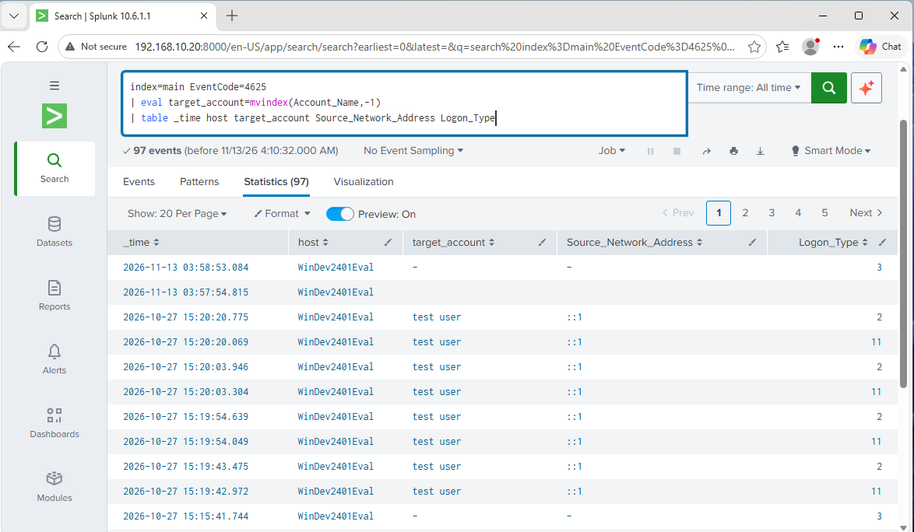

# Failed Login Analyzer

A small Python tool that reads a Splunk CSV export of Windows failed logons (Event ID 4625) and flags accounts and sources with repeated failures in a time window. It applies the same threshold-in-a-window logic as the scheduled Splunk alert in my [SOC Home Lab](https://github.com/francisr94/Cybersecurity-SOC-HomeLab).

## Usage
```
python failed_logins.py failed_logins.csv --threshold 5 --window 5
```

Options: `--threshold`, `--window` (minutes), `--include-machine-accounts`, and field-name overrides.

## Getting the data
Run this in Splunk and export the results as CSV:
```
index=main EventCode=4625
| eval target_account=mvindex(Account_Name,-1)
| table _time host target_account Source_Network_Address Logon_Type
```

## Example output


## How it works
Events are grouped by account and source address. A sliding window finds the largest number of failures within the window, and groups at or above the threshold are flagged. Machine accounts (names ending in `$`) are excluded by default.

## Limitations
- Works on exported CSV files, not live logs.
- A failed login alone does not establish a brute-force attack; review flagged results in context.
- `sample/sample_4625.csv` is synthetic test data.
